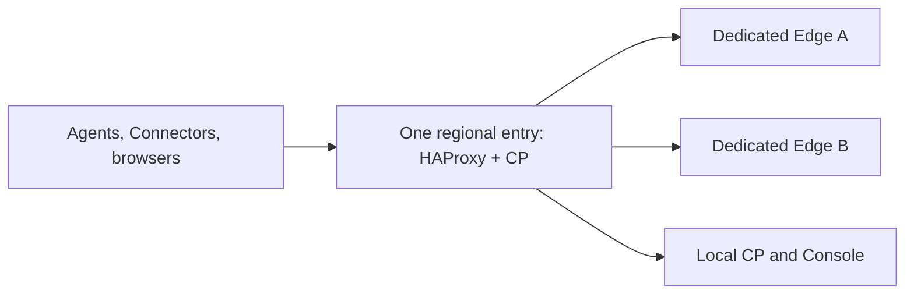

# One region with dedicated Edges

This is the separate single-entrance authentication-evaluation profile. It does
not replace the existing three-combined-node, three-independent-entrance topology.
See the [three-entrance installation guide](releases/0.4.0/install-multi-edge.md)
for that topology and the reviewed shared-fleet target.

The development profile `one-region-multi-edge` places one Control Plane and its
HAProxy TCP doorway on one machine, with at least two dedicated Edge machines.
The database, consensus store and Console stay on the CP machine. Edge machines
carry no database, CP service or offline CA signing keys.



This topology provides Edge redundancy. The CP, durable state and public entry
remain a single point of failure. It cannot replace a three-voter deployment
when authority or regional availability is required.

Start with [the plan example](plans/one-region-multi-edge.json). Set stable private
addresses, peer TLS names and independent failure domains. The installer validates
one state-bearing DSSE region, exactly one dedicated CP/L4 machine and at least two
dedicated Edges. It does not create cloud resources or implement public-IP failover.

Generate and inspect the order before installing:

```sh
dsse-install -plan plan.json -dir /opt/dsse -order
```

Run the commands on the named machines. Bootstrap the administrator on the CP,
restart that CP to close bootstrap access, then carry and start each Edge. This
profile has one state-bearing host; do not add fake voters or enable strict
database replication without actual replicas.

## Private network requirements

The operator supplies routing and firewall rules. In the generated default port
layout, allow these paths between the declared machines:

| Source | Destination | TCP port | Purpose |
| --- | --- | --- | --- |
| Regional doorway | Every Edge | 8443 | TLS passthrough for agent, Connector and Portal connections |
| Regional doorway | Every Edge | 9443 | Private, certificate-verified health checks and owned administration |
| Every Edge | Every other Edge in the same region | 8443 | Authenticated sibling relay over the declared private peer TLS names |
| Every Edge | CP authority/admin entry | 443 | Signed configuration, identity and grant synchronization |
| Browsers and Edges | Registered IdP | 443 | OIDC authentication, token exchange and key discovery |

Use the generated order if ports are customized. Keep Edge backend ports private;
permitting the doorway to reach them does not permit sibling Edges to reach each
other. A healthy Edge whose local Connector tunnel is still reconnecting needs
the authenticated sibling path to carry a private-app request through another
Edge. Blocking that path can produce failures immediately after the restored
Edge re-enters load balancing, even though health checks pass.

Verify actual mutual TLS peer links, private-app traffic and Connector coverage,
as well as TCP reachability. Serve the Portal and Console with suitable
browser-trusted certificates and reachable signed revocation information when
clients require online revocation checks; do not disable certificate checks to
compensate for an incomplete certificate deployment.

## Shared regional authentication portal

Every Edge uses `https://portal.<region>.<deployment>`. This name is shared across
tenants and resolves to the CP/L4 entry. HAProxy forwards its TLS connections to
healthy Edges with round-robin selection. Agent and Connector mux connections use
the separate least-connection Edge backend. TLS terminates at the selected Edge,
and each Edge must have a browser-trusted certificate for the common Portal name.
Private admin health checks verify the deployment CA and TLS name.

Admin Console traffic goes to the CP's Console. Node-specific admin names retain
their exact owner; they are never balanced over unrelated Edges. The generated
client hosts map requires only the CP/L4 public entry, not Edge public addresses.

Before authentication, verify all of the following:

- All CP and Edge processes run compatible builds and report support for
  `ceremony-recovery-v1`. Activate it through the existing fleet capability
  consensus API and verify that every Edge has applied the activation.
- The carried `STEPUP_BINDING_SECRET` is identical across Edges. Do not generate
  per-Edge secrets or copy offline CA signing keys to Edge hosts.
- Every Edge uses the same Portal origin and presents a TLS certificate valid
  for that name. Configure the IdP's exact callback for that shared origin.
- Issued endpoint profiles contain that exact origin in
  `deployment.step_up_portal_origins`. Test strict TLS and revocation validation,
  IPv4/IPv6 egress, Console trust and the complete browser certificate chain.

With sealed recovery enabled, the Edge receiving an OIDC callback can restore the
pending ceremony created by another Edge and redeem it once through the CP. A
healthy TCP listener alone does not establish this readiness.

## Acceptance checks

Verify ordinary access, policy deny and tenant isolation first. Then measure
initial authentication, both Edges using the same grant without a new login,
grant expiry and administrative revocation requiring fresh identity evidence.

Start an authentication ceremony, stop its original Edge, and finish in the same
browser through the common Portal. Record callback success on the surviving Edge,
one-time redemption, grant publication and subsequent authorized access. Also
test a restored Edge and expired or replayed browser callbacks.

A TCP stream owned by a stopped Edge cannot migrate to another process. Separate
browser-callback recovery and a new application connection from resuming the
original stream. The native hold timer and browser ceremony deadline are separate;
see [authentication failure behavior](device-user-authentication.md).

External IdP/Connector fixtures are additional test infrastructure, not extra DSSE
regions. This profile does not claim a successful AWS or physical-endpoint test
merely because generated configuration and local checks pass.
